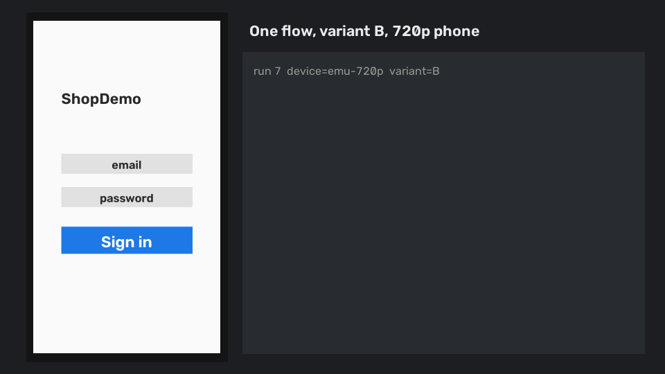
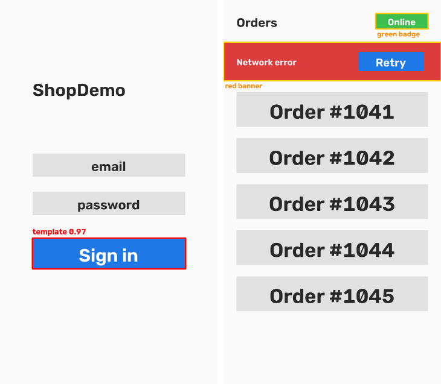
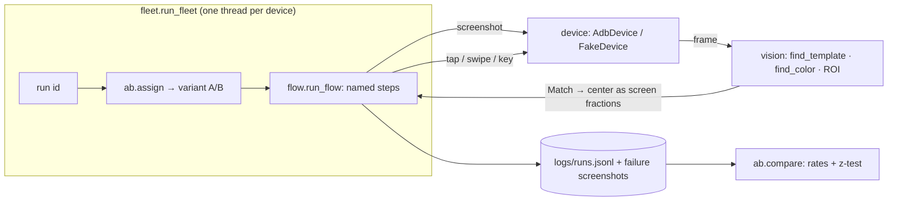

# Android CV Automation

    

Drive Android apps **by what is on the screen**, the way a human tester does: take a screenshot, find the button or status, tap it, check the result. Works where Appium/UIAutomator can't see the elements (Unity, Flutter, canvas/WebGL, WebView, kiosk and legacy apps), and scales from one phone to a fleet of devices in parallel.

This repo is a clean, minimal version of the toolkit I use to run computer-vision automation on **30+ cloud Android devices 24/7** (Python + OpenCV + adb). Everything below runs **without a phone**: the demo app and the devices are simulated.

## Demo



*Rendered by [`tools/make_demo_gif.py`](tools/make_demo_gif.py) from real runs of the library. Part 1: one flow on a 720p phone: the "Sign in" template (cut on a 1080p screen) is found at another scale, an error banner is detected by colour, variant B taps "Retry", the green badge confirms success. Part 2: the same flow on 6 devices in parallel; the hung device is taken out of rotation and the A/B test reports whether B is really better.*



*Left: a button template cut once on a 1080p screen, found on a 720p screen. Right: colour detection of a status badge and an error banner on a 1440p screen.*

## What it does
- **Screen recognition.** Multi-scale template matching (one template works on 720p, 1080p and 1440p devices) and HSV colour detection (status badges, error banners, progress bars). Regions of interest make it fast and precise.
- **Resolution-independent actions.** All taps and swipes use fractions of the screen (0..1), so one script runs on every device size.
- **Flows with evidence.** A flow is a list of named steps. Each run records step timings; a failed run saves the last screenshot, e.g. `logs/fail_phone-2_7_wait_result.png`.
- **Fleet runner.** One worker per device, all in parallel. Every run is a JSON line in `logs/runs.jsonl`. A hung device (timeouts / adb errors in a row) is taken out of rotation while the others keep working. Normal test failures do not disable a device.
- **Honest A/B tests.** Each run gets variant A or B by a deterministic hash of the run id, so both variants run on all devices at the same time. `compare()` gives success rates and a two-proportion z-test: "B is better" is reported only when the difference is not noise.
- **Defensive adb.** Every adb call has a timeout; screenshots are retried; errors become `DeviceError` so the runner can react.

## Quick start (no phone needed)
```bash
git clone <this repo> && cd android-cv-automation
python3 -m venv .venv && source .venv/bin/activate
pip install -r requirements.txt
python examples/demo_offline.py     # 6 simulated devices, ~20 s
python -m pytest -q                 # 10 tests, ~10 s
```
Example output (real run; numbers change a little between runs because devices run in parallel threads):
```
device            runs    ok    ok%   avg s
cloud-frozen         3     0   0.0%    3.14  DISABLED
emu-720p-1          20    19  95.0%    0.65
emu-720p-2          20    19  95.0%    0.62
phone-1080p-1       20    17  85.0%    0.54
phone-1080p-2       20    16  80.0%    0.59
tablet-1440p        20    18  90.0%    0.77
TOTAL              103    89  86.4%

A/B (A = fail on error banner, B = tap Retry):  A 77.1% of 48 · B 100.0% of 52  ->  z 3.66, p 0.00025, B better

example failure: phone-1080p-2 run 7: wait_result: StepFailed: network error banner
  screenshot: logs/fail_phone-1080p-2_7_wait_result.png
```
The demo app (`examples/fake_app.py`) is drawn with OpenCV: login → loading → home, and 25 % of logins show a red "Network error" banner. Variant B recognises the banner and taps "Retry".

## Real devices
Anything reachable through `adb` works: USB phones, Android Studio emulators, cloud phones.
```bash
adb devices                                   # list connected devices
python examples/settings_smoke.py             # opens Settings on every device, scrolls, goes home
python examples/settings_smoke.py --serial emulator-5554 --runs 5
python -m acva.ab logs/runs.jsonl             # A/B report from any log
python -m acva.hsv screenshot.png 540 1200    # HSV of a pixel + suggested colour range
```

## Write your own flow
```python
from acva import AdbDevice, find_template, find_color, run_fleet
from acva.vision import GREEN
import cv2

LOGIN = cv2.imread("templates/login_button.png")   # cut once from a screenshot

def tap_login(ctx):
    m = ctx.wait_for(lambda s: find_template(s, LOGIN, 0.85), timeout=10, what="login button")
    ctx.tap_match(m)

def logged_in(ctx):
    ctx.wait_for(lambda s: find_color(s, *GREEN, roi=(0.6, 0, 1, 0.1)), timeout=15, what="green status")

devices = [AdbDevice(s) for s in AdbDevice.list_serials()]
report = run_fleet(devices, [("tap_login", tap_login), ("logged_in", logged_in)], runs_per_device=10)
print(report.summary())
```

## Architecture

- **`device`** hides the transport. `AdbDevice` wraps the adb CLI with timeouts and retries; `FakeDevice` is a scripted state machine for tests and demos. Both expose `screenshot / tap / swipe` in screen fractions.
- **`vision`** answers "where is X?" and returns a `Match` whose `center` goes straight into `tap()`.
- **`flow`** runs the steps of one run, measures each step and keeps the last frame for the failure report.
- **`fleet`** runs flows on all devices in parallel, writes one JSON line per run and disables devices that keep timing out.
- **`ab`** assigns variants and decides if a change really helped.

```
acva/
  device.py   AdbDevice (timeouts, retries, fractions) + FakeDevice (scripted screens for tests)
  vision.py   find_template (multi-scale), find_color (HSV blobs), color_share, ROI crop
  flow.py     Ctx.wait_for / tap_match, run_flow -> RunResult (timings, error, failure screenshot)
  fleet.py    run_fleet: parallel devices, JSONL log, hung-device detection, summary table
  ab.py       deterministic A/B assignment + significance test
  hsv.py      pixel colour picker
examples/
  fake_app.py        drawn 4-screen app at any resolution
  demo_offline.py    the demo above
  settings_smoke.py  real-device smoke test on stock Android
tools/
  make_demo_gif.py   renders docs/demo.gif from real runs (needs requirements-dev.txt)
tests/               10 pytest checks
```

## Tests
```bash
python -m pytest -q
```
| Test | What it proves |
|---|---|
| `test_template_found_on_every_resolution` (×3) | a template cut on 1080p is found on 720p, 1080p and 1440p, and its centre lands inside the button |
| `test_template_absent_returns_none` | no false positive on a screen without the button |
| `test_color_blobs` | HSV detection finds the badge / banner and ignores screens without them |
| `test_roi_crop_offsets` | region-of-interest coordinates map back to the full screen |
| `test_flow_success_and_failure_screenshot` | a flow passes, fails with a saved screenshot, and variant B recovers |
| `test_fleet_disables_hung_device_only` | a hung device is disabled, app errors don't disable a device, every run is logged |
| `test_ab_assignment_balanced_and_deterministic` | A/B split is ~50/50 and repeatable |
| `test_ab_compare_significance` | a real difference is reported as significant, equal results are not |

CI (`.github/workflows/tests.yml`) runs the tests and the demo on Python 3.9 and 3.12.

## Use cases
For apps **you own or are authorised to test**:
- **Smoke / regression tests** of screens that Appium can't inspect (Unity or canvas UIs, Flutter, WebView, custom-drawn widgets).
- **Hourly health checks** of your production app on real devices: log in, open the main screen, alert on failure with a screenshot.
- **Device-matrix testing**: the same flow on many resolutions and Android versions in parallel.
- **Kiosk and internal apps**: repetitive data entry or setup steps on a fleet of company devices.
- **Measuring a fix**: run the old and new behaviour side by side as an A/B test across the fleet before shipping.

## Production notes (from running a real fleet)
- `adb exec-out screencap` costs 0.2–1.5 s per frame on real phones. For fast loops, read frames from a scrcpy video stream and keep screencap as a fallback when the stream stalls.
- A stream can look alive while sending nothing. Count frames per 30 s, and reconnect when the count is zero.
- Cloud phones hang. Run the bot under a watchdog that restarts it, and keep a per-device flag file (`STOP`, `BUSY`) so humans and scripts don't collide.
- Deploy to many devices with a retry loop and a timeout per device; report "started / NOT started" per device.
- Use A/B tests on the whole fleet, not "try it on one device for an evening": devices differ more than most changes do.

## Use responsibly
Automate only apps you own or are authorised to test, and respect the terms of service of third-party apps. This project is not meant for fake accounts, spam, ad clicks or bypassing app protections.

## License
[MIT](LICENSE)
